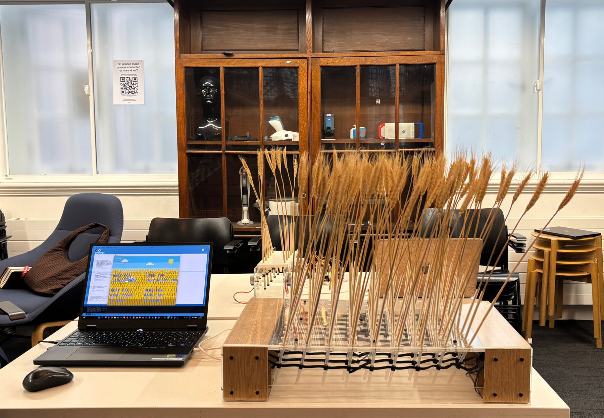
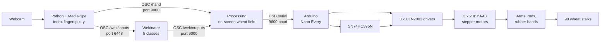
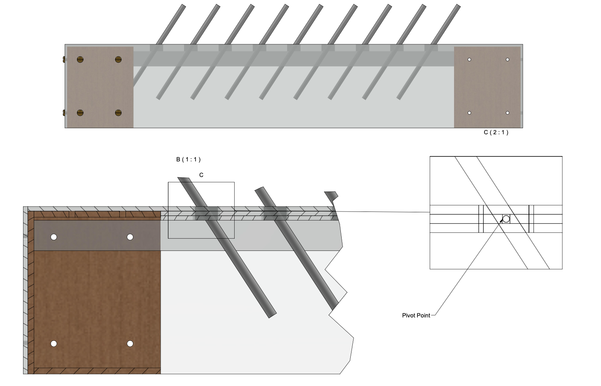
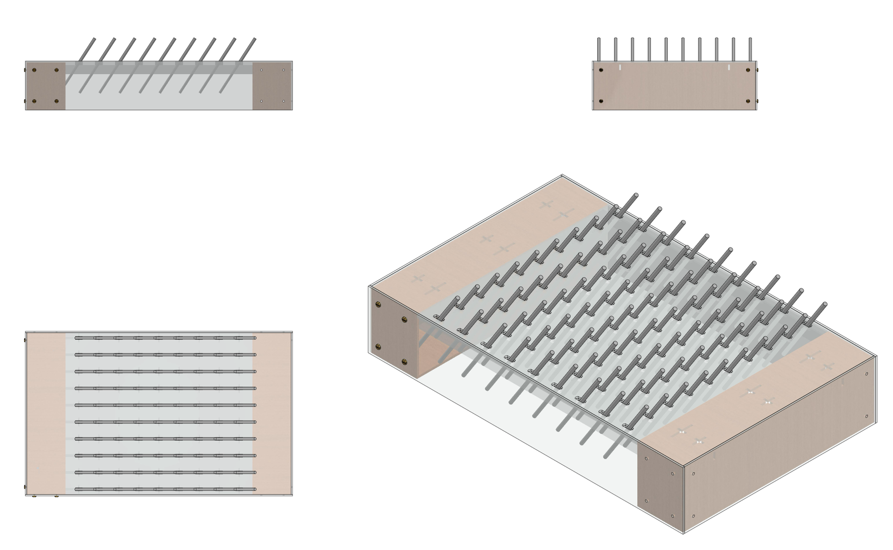
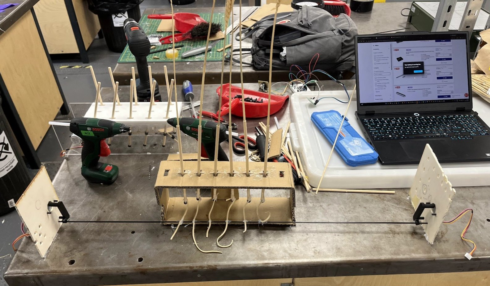
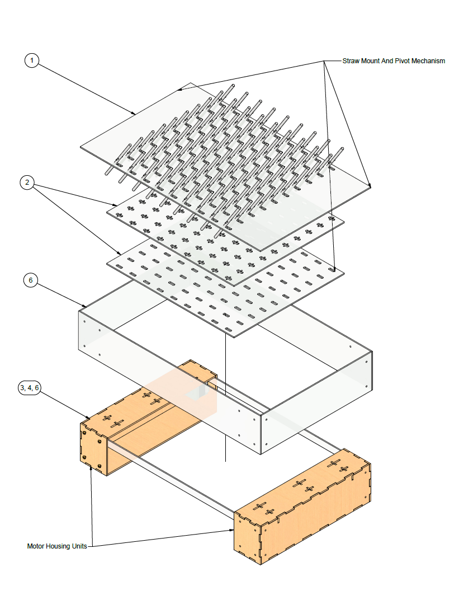
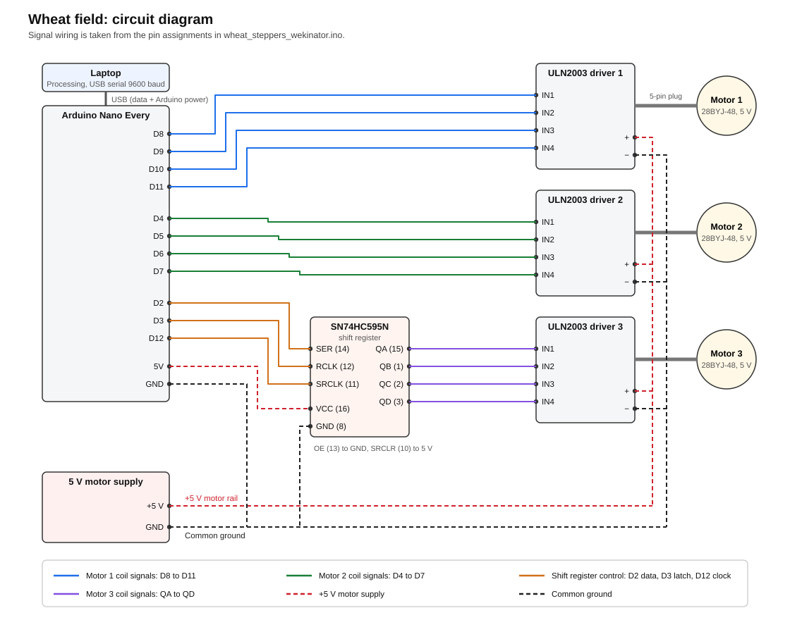
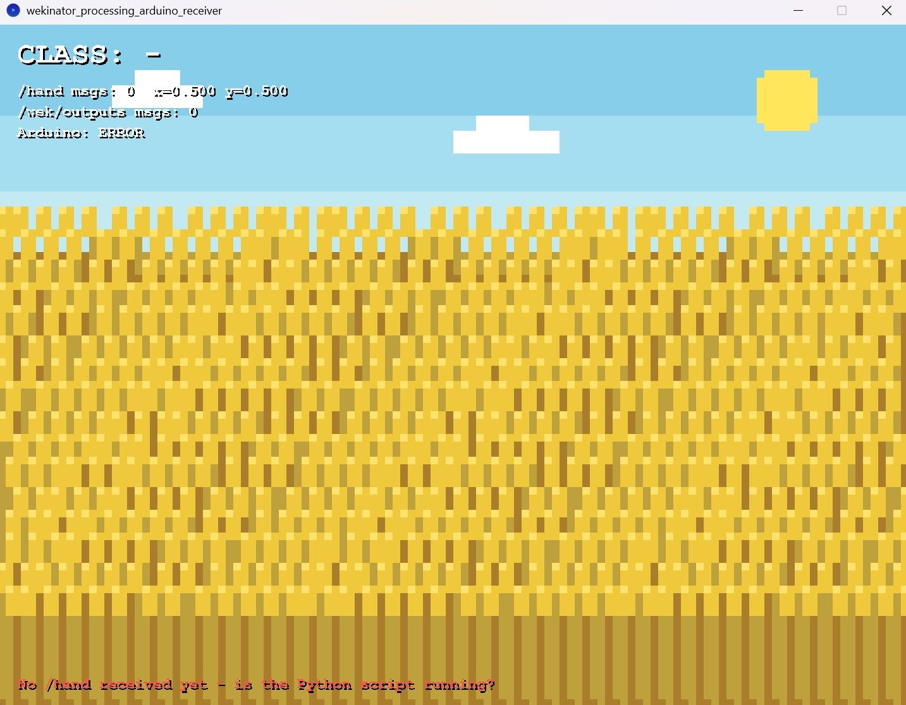
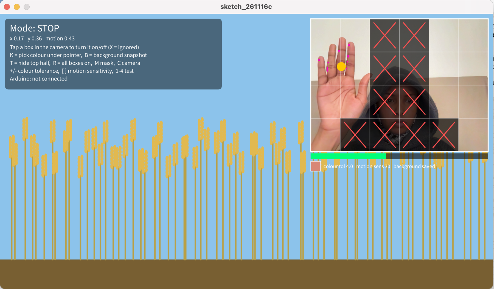
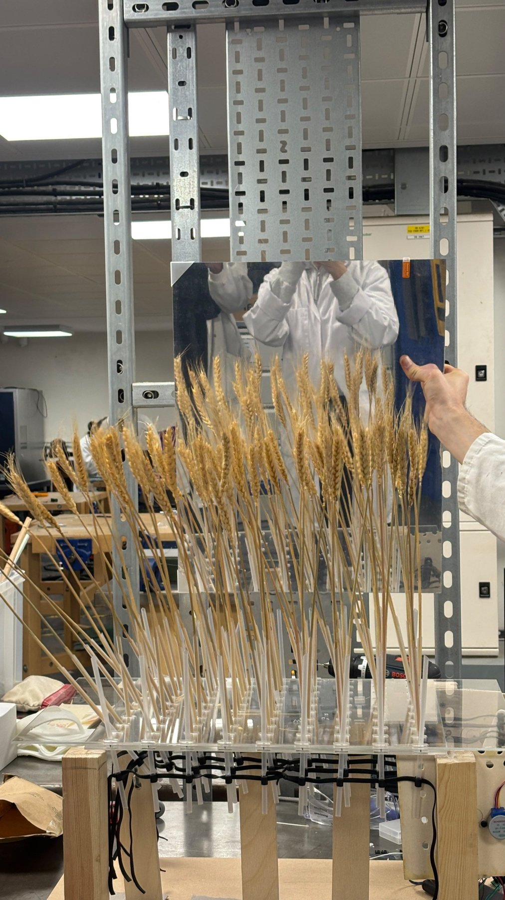

# A Wheat Field Interactive Mechanism

A field of 90 mechanical wheat stalks that sways in response to the user's hand, using a webcam, MediaPipe hand tracking, Wekinator and an Arduino driving three stepper motors.

**Group 1:** Ferdia Comerford, Hani Ali, Zhuohan Dai

**Unit:** Cyber Physical Systems, D7 Group Project Documentation

**Project files:** [Google Drive folder](https://drive.google.com/drive/folders/1OdE6lRw72tal6oAJspWh-RoBC7dsoHpi) (source code, Wekinator project, CAD, photos and video)

*Figure 1: the wheat field and its on-screen interface at the demo day. Moving a fingertip into one of the four areas on screen selects how the wheat moves.*

| Media | Links |
| --- | --- |
| Finished installation | [05 Final build - wheat field, close view.jpg](https://drive.google.com/file/d/1zS4jCq0RYi6qEr48oka7N4M5GCAXxQ4N/view), [05 Final build - wheat field on the workbench.jpg](https://drive.google.com/file/d/1b7hobbeua0SwQqjEsX9s1JfVc2KeV54d/view), [06 Demo day - presenting the wheat field.jpg](https://drive.google.com/file/d/16kc4ftU30Bm0r_I4_-JqfCieYL4-66DV/view) |
| Video | [Demo day video 01.MOV](https://drive.google.com/file/d/1FVPfstjxt6_TdDzALpqEkBDZRyymeida/view), [Demo day video 02.MOV](https://drive.google.com/file/d/1iZK3IQ5j_J4_lkHLR0QV0CtapF1RFvTr/view) (demo day), [Wheat field video.MOV](https://drive.google.com/file/d/1yAXLikDMKHn-RomSklfUOikV207egOOt/view) |
| Demo day photos | [Demo day folder](https://drive.google.com/drive/folders/1w8jI4-lcO2L3rafRmgs-5Qfff9VMBBnS) |

## Contents

- [Overall concept](#overall-concept)
- [From robot arm to wheat field](#from-robot-arm-to-wheat-field)
- [Mechanical design](#mechanical-design)
- [Hardware design](#hardware-design)
- [Software design](#software-design)
- [Machine learning](#machine-learning)
- [Interaction design](#interaction-design)
- [Development process](#development-process)
- [Limitations and future work](#limitations-and-future-work)
- [AI usage disclaimer](#ai-usage-disclaimer)
- [References and credits](#references-and-credits)
- [Appendix](#appendix)

---

## Overall concept

*Criteria (ILO1). Pass: the project has a cohesive purpose. Excellent: aesthetic details such as material choice and construction reinforce the design concept; the physical object is clearly photographed; user interaction is fully explained and justified.*

Our project explores how a hand can control the movement of an interactive wheat field. The installation stays still and calm until a hand is held in front of the camera. The system tracks the hand's position across different areas of the camera view and translates it into different movement patterns: a single sway, a continuous sway, a wave from left to right, and a wave from right to left. When the user chooses the stop position, the field settles back to rest.

The inspiration is the natural movement of a wheat field when wind passes through it. Rather than simply replicating the appearance of wind, the project explores how mechanical motion can imitate the rhythm and flow of nature, so that technology feels gentle, intuitive and inviting rather than mechanical. The user's hand takes the place of the wind.

How each part of the system supports the concept:

| Part | Role in the concept |
| --- | --- |
| Material | Real wheat stalks, with clear acrylic so the structure visually disappears |
| Mechanical design | Flexible, one-sided drive so movement ripples across the field instead of moving as one rigid block |
| Hardware | Three small stepper motors hidden beneath the field, so only the wheat is visible |
| Software | Hand tracking that follows the user's hand and nothing else in the room |
| Machine learning | Behaviours trained by example, so they can be tuned by feel instead of hand-written rules |

### References that shaped the concept

We looked at kinetic works in which many rods or stalks move together, including pieces by Arthur Ganson, Takis and Alexander Calder, Laurence Perratzi's *Butterfly*, and David Bowen's *Tele-Present Wind*, in which 126 tilting devices each move a dried plant stalk from live wind data. Bowen's work showed that natural stalks can carry this kind of installation.

### Material choice

Wheat is the core of the concept, so we kept real stalks as the main visual material and built the mechanism around their fragility. We considered and rejected other materials:

| Material | Used | Reason |
| --- | --- | --- |
| Wheat | Yes | Core of the concept; easy to source; a supporting mechanism carries the movement so the stalks do not have to |
| Fine metal wire | No | Rigid and mechanical, which is what we wanted to avoid |
| Steel wire brush | No | Too dense and heavy to pivot and ripple; reads as industrial |
| Brush strands | No | Hard to pivot individually; cannot be tuned for weight, pivot position or spacing |
| Dried flowers | No | As fragile as wheat but without the linear stalk form, so no coherent field-wide ripple |
| Feathers | No | Too light and unpredictable to tilt and settle in a controlled way |
| Metal leaves | No | Heavy and reflective, against the soft feel of the concept |
| Paper | No | Not used in the final design; straws and dowels were the prototyping stand-ins |

---

## From robot arm to wheat field

*Criteria (ILO4). Pass: the robot arm has been modified in some way. Excellent: the robot arm has been significantly improved, or a new system has been produced that exceeds the performance of the original robot arm.*

We started from the unit's robot arm lab and replaced the arm with a new system.

| Aspect | Robot arm lab | Wheat field |
| --- | --- | --- |
| Actuators | 4 servos (pins 9, 7, 5, 3) | 3 x 28BYJ-48 stepper motors moving 90 stalks |
| Mechanism | Laser-cut arm, one servo per joint | Arms, carbon-fibre rods and rubber bands, one motor per line of wheat |
| Input | Mouse position on a 3 x 3 grid | Webcam and MediaPipe hand tracking |
| Wekinator | 1 classifier, 9 classes | 1 classifier, 5 classes |
| Bridge | Provided Processing sketch, OSC to serial at 9600 baud | Our own Processing sketch, same OSC-to-serial idea, with an on-screen wheat field |
| Arduino code | `switch` on the class number, one servo position per class | State machine with homing, waves and safe transitions between classes |
| Board | Arduino Nano Every | Arduino Nano Every |

We kept the pipeline from the arm (Wekinator class, Processing, serial, Arduino) and the same way of debugging, testing each unit alone before joining them. The physical build, the input method and the motor control are all new.

The wheat field does more than the original arm in four ways:

- The arm used four servos to move one linkage. Here three stepper motors move 90 separate stalks, because each motor drives a whole line through a shared rod and rubber bands.
- The arm was controlled with a mouse. The wheat field is controlled without contact, by a hand in front of a webcam.
- The Arduino sketch finds its own starting position at power-up and after every movement, so the system keeps working over long runs without anyone resetting it.
- The arm moved to one fixed position per class. The wheat field runs timed, continuous movements (sways and travelling waves) and changes between them smoothly.

The Arduino Nano Every from the robot arm lab is reused as the controller. No mechanical parts of the arm are used in the final build; the mechanism, structure and drive were designed and made from scratch.

Lab repository: `ZhuohanDai/Robot-Arm-and-Machine-Learning-Group-1` on GitHub.

---

## Mechanical design

*Criteria (ILO4). Pass: appropriate mechanisms and structures were chosen for the task; documentation is sufficient to understand the project without an in-person demo. Excellent: suitable mechanisms, structure, materials and fabrication processes that align with the system's goals; design decisions, specifications and construction processes are well documented.*

### Overview

The installation consists of 90 individual wheat elements, arranged in 9 columns and 10 rows. Each wheat element is mounted on a drinking straw, which lets it sway from side to side. The whole model measures 600 x 370 mm.

The mechanical system has two main structures:

1. The **wheat movement and connection structure** (upper), which holds and guides the stalks.
2. The **motor and transmission structure** (lower), which passes movement up to them.

**CAD:** [full model, STEP](https://drive.google.com/file/d/1D8M9pgc-_lr7cmX1--4iSrqIEYoD2m7S/view) · [full laser-cut file, DXF](https://drive.google.com/file/d/1MeDZwuqNgpVqW66pyDLpT8He6ms4vJ-R/view) · [Inventor assembly and parts](https://drive.google.com/drive/folders/1W2KIRzcofL2WC3fReN_aCc3J1FheRhjK) · [all final CAD](https://drive.google.com/drive/folders/1jbjtWq4p1FQ0DR8v5CAb1ustgin0VAbI)

*Figure 3: side view of the model with section B (1:1) and detail C (2:1). Each straw passes at an angle through the stacked acrylic layers of the top board. Detail C shows the pivot point, where the layers hold the straw at one height so it can tilt from side to side without sliding or twisting.*

*Figure 4: CAD model of the base and guide structure, shown in side, end, top and isometric views. The clear acrylic top board holds the straws in a grid at a fixed spacing, and the wooden end blocks raise it to leave space underneath for the motors, rods and rubber-band links.*

### 1. Wheat movement and connection structure

The upper structure supports and guides the individual wheat elements. It lets them tilt and sway while always returning towards their original positions.

Our early prototyping shaped its design. Those tests showed that loose rods in a single drilled board moved chaotically, and that constraining the base of each stalk was what turned random movement into a coordinated, field-like ripple (see Development process).

**Three stacked acrylic layers.** We made the upper structure from three layers of laser-cut clear acrylic, each with holes of a different size. Stacking the layers constrains each straw at several heights rather than one, which creates a controlled pivot point. The straw can tilt side to side but cannot lean or twist in unwanted directions. Varying the hole sizes lets us tune how much freedom each layer allows, balancing stability against range of movement.

- We chose **clear acrylic** so the structure visually disappears and attention stays on the wheat.
- We chose **laser cutting** for precision and repeatability. Uneven hole spacing caused tangling in our earlier tests, so many identical holes at consistent spacing mattered.

Photos: [03 Laser cutting - panels on the cutter bed.jpg](https://drive.google.com/file/d/1M4ZQOImKsGLhpzYlzUM1W5yUUcw_Nr5v/view), [03 Laser-cut parts - hole plates and side panels.jpg](https://drive.google.com/file/d/1rY2_9oXTyoCdDGmUJWUnSGP2HEfIRlcm/view)

**Custom 3D-printed connector.** A connector sits between the layers and holds each drinking straw in place. Designing our own meant it fits the straw and the acrylic exactly, is easy to reproduce across the whole field, and is easy to adjust between iterations.

**Rubber-band links.** At the base, rubber bands link the wheat elements in each row to the transmission mechanism below. A 3D-printed holder clips each band to its straw ([Rubber Band Holder.stl](https://drive.google.com/file/d/1T4MgrCSARiAIqBn8dAALoFAGF3CJO4OX/view)). We chose an elastic connection over a rigid one deliberately:

| Option tried or considered | Result |
| --- | --- |
| Magnets moved beneath steel-tipped stalks | Abrupt, jerky movement ([02 Magnet test 1 - rods held upright.jpg](https://drive.google.com/file/d/1HFIOdp2oFspYOtsYjIEjdyCdwYyVJjZ6/view), [02 Magnet test 2 - testing at the workbench.png](https://drive.google.com/file/d/18ZgBnReU9OxX5-P4S6gFG3lzq1HltcMq/view)) |
| Fixed, rigid linkage | Every stalk would copy the mechanism exactly, which reads as mechanical |
| **Rubber bands (chosen)** | Each element flexes slightly, with small delays and variations between stalks, then springs back towards rest |

This softness is what makes the movement feel organic, closer to wheat bending in the wind than to a machine moving in unison.

The holder went through at least nine versions. The earlier ones are kept in the [prototype CAD folder](https://drive.google.com/drive/folders/1sBgwjHaUUkldb-o9qjDf9NQR1V5mq9Hb) (`Rubber Band Holder_V4.stl` to `_v9.stl`, and the multi-part versions 3 and 10).

### 2. Motor and transmission structure

The lower structure houses the motors and transmission components. It holds three stepper motors along one side, each connected to a thin carbon-fibre rod that runs beneath the wheat.

**One motor per rod, not one per stalk.** Driving every stalk individually would have needed far more motors and made the mechanism hard to repeat. Instead, each motor drives a whole line of wheat through a single rod. Our tests confirmed this: one input applied to a connected row carried movement across several wheat elements and produced a more collective response ([01 Prototype 5 - long row rig with electronics.jpg](https://drive.google.com/file/d/1ApcJcS3j_AdiKIePoMZVAC17npZcZHdf/view), [01 Prototype 5 - long row rig, end view.jpg](https://drive.google.com/file/d/1VEg0_TuYGOdu1LK2L4nAj9434FuYIdZw/view)).

**Connecting arms.** A 3D-printed arm links each motor shaft to its rod. As the motor rotates, the arm pushes and pulls the rod, and the movement passes through the rubber bands to the base of each wheat element. We refined this linkage through several iterations:

| Iteration | Observation | Change made |
| --- | --- | --- |
| Short rotation shaft | We assumed a shorter shaft would move faster. It barely produced any swing. | Lengthened the shaft |
| Rubber-band clamp high on the arm | Small displacement | Moved the clamp further down the arm, which gave a wider and quicker swing |
| Rod positioned centrally | Transferred very little motion | Moved the rod closer to the mechanism, keeping its length to suit the final model |

These small adjustments showed how sensitive the overall effect is to geometry. The arrangement of the linkage mattered as much as the motors themselves. An early cam-shaft version is in the prototype folder (`CAM Shaft 3.stl`).

**Six motors reduced to three.** During development we tested six motors, three on each side, driving every rod from both ends. It worked mechanically, but it constrained each rod completely. Every wheat element followed the motors exactly, so the field moved as one rigid, synchronised mass with no variation between rows.

Real wheat does not behave like this. Wind reaches different parts of a field at slightly different moments, and each stalk bends, lags and recovers on its own. We therefore drive the rods from one side only and leave the opposite ends free, so the back of the structure can flex.

- Movement now travels along each rod gradually rather than instantly.
- Elements further from the motor respond with a slight delay and a softer, looser sway.
- These irregularities create a ripple across the field that the fully driven system could not.
- Three motors instead of six also cut weight, wiring, power use and control complexity.

The main thing we learnt here was that giving up some control made the installation simpler and more convincing.

**The end stop as a reference.** The wheat can only be pushed so far forward before the mechanism stops. The motor control uses this physical stop to re-find its starting position (see Motor control), so the mechanism needs no limit switches.

*Figure 5: single-row prototype. Six wheat stalks stand in a cardboard frame, each tied at its base to a thin rod that runs between two motor mounts, one at each end of the bench. Turning the motors moves the rod, which pulls every stalk in the row together. This test showed that one rod could drive a whole line of wheat.*

### Support structure

The support structure holds the wheat elements, motors and linkages in fixed positions, so that movement from the stepper motors passes cleanly to the wheat without parts shifting, slipping or tangling.

*Figure 6: exploded view showing the straw mount and pivot layers (1, 2), the acrylic frame (6) and the two motor housing units (3, 4, 6).*

| No. | Part | What it does | CAD |
| --- | --- | --- | --- |
| 1 | Top board | A flat board with a grid of holes holds each wheat element upright at a set spacing. Stalks are close enough to move as a field, but far enough apart that they do not cross or tangle. | `Wheat Holder Top Layer.ipt`, `Wheat Holder Bottom Layer.ipt` |
| 2 | Base guide | A border fixed beneath the board constrains the base of each wheat element. A controlled pivot at the base is what makes the movement read as coordinated rather than chaotic. | — |
| 3 | Motor mounts | Hold the three stepper motors in fixed alignment along one side. They stop the motors rotating or shifting under load, so every movement is transferred accurately to the rods. | `Motor Mount.ipt` |
| 4 | Connecting arms and rods | 3D-printed arms link each motor shaft to a thin carbon-fibre rod. The rods are fixed only on the motor side, leaving the opposite ends free to flex. | — |
| 5 | Rubber-band connections | Attach the carbon-fibre rods to the base of each wheat element. They hold the elements securely while letting each one move with slight independence. | [Rubber Band Holder.stl](https://drive.google.com/file/d/1T4MgrCSARiAIqBn8dAALoFAGF3CJO4OX/view) |
| 6 | Lower enclosure | Raises the wheat field and creates a gap underneath for the mechanism. It houses the Arduino, stepper drivers, shift register and wiring, keeping the electronics hidden and protected. | `Box Base.ipt`, `Wood Box Top.ipt`, `Wood Box Long End.ipt`, `Wood Box Short Side.ipt` ([03 Wooden base box - cutting and taping.jpg](https://drive.google.com/file/d/1Zi2NyqbTJ0VnbeDIx7mEC_OSVpGzcr-j/view)) |

The Inventor part files named above are in the [Pack And Go folder](https://drive.google.com/drive/folders/1W2KIRzcofL2WC3fReN_aCc3J1FheRhjK).

### Materials and fabrication

| Material | Used for | Process | Why |
| --- | --- | --- | --- |
| Clear acrylic, 3 mm and 5 mm | Guide layers, top board, side panels | Laser cut | Precision and rigidity where the structure must stay fixed; visually disappears |
| MDF and timber | Lower enclosure, legs | Laser cut, hand tools | Rigidity at low cost |
| PLA | Straw connectors, rubber-band holders, connecting arms, motor mounts, assembly jigs | 3D printed | Custom fit, repeatable, quick to iterate |
| Carbon-fibre rods | Transmission along each row | Bought | Light and slightly flexible |
| Rubber bands | Link between rods and stalks | Bought | Elastic, gives the organic lag and return |
| Vinyl wrap | Around the motor boxes | Hand applied | Improves the look of the box |

### Assembly

**Assembly jig.** The final installation has 90 wheat elements, so assembly had to be efficient and consistent. The heights and positions of key components, including the central stopping points along the straws and the connections between straws and rubber bands, needed to be precisely aligned.

We designed custom assembly jigs with pre-defined holes at specific heights ([Assembly Jig 01.stl](https://drive.google.com/file/d/1TU89xw8liBfEQI0XbDr6yN6UkoJmNbIm/view), [Assembly Jig 02.stl](https://drive.google.com/file/d/13z2I8qq5lHxKe36Lar6Q8kvO5mZOH3FJ/view)). They let us position the straws and insert the connecting components consistently, reducing manual adjustment and making the build faster and more reliable.

Photos of the build: [04 Assembly - straws fitted in the frame, before wheat.jpg](https://drive.google.com/file/d/19p7tmv9r6FX389tRwEwhxATKTp0je-Sn/view), [04 Straw assembly - fitting the connector.jpg](https://drive.google.com/file/d/1ZjTU0emPOc--UALdTHkgMT_J6WqnSZKy/view), [04 Straw assembly - single stalk with connector and rubber band.jpg](https://drive.google.com/file/d/1vHKxABQBHnBR4pztTh7esPhte9sJK-Fk/view), [04 Assembly - top board clamped to the workbench.jpg](https://drive.google.com/file/d/1ZWAlmAtQQO1QflsgfES44V_zmGUsbUMZ/view), [04 Gluing straws into the board - step 1.jpg](https://drive.google.com/file/d/1N1PG7igW60-q6k8pcLERfWnFkt9_Hxzb/view) (and steps 2 to 6 in the [Images folder](https://drive.google.com/drive/folders/1ypoME2gIAfV2fcM3QhtKYPtGmGROLXdT)), [02 Balance test - board at the workbench.jpg](https://drive.google.com/file/d/1nK2-dLDrSzVPs_A3iDFNZuUJxwcItoIc/view).

---

## Hardware design

*Criteria (ILO4). Pass: a list of all hardware components is provided; the project is powered safely. Excellent: the choice of each component is clearly justified; circuit diagrams are included; circuits are robust enough to withstand the designed movements; the work could be reproduced; power consumption is estimated.*

The hardware turns the position of a user's hand into physical movement of the wheat field. We chose each component to keep the system simple, reliable and easy to repeat.

### Components

| Component | Qty in use | Task | Why we chose it |
| --- | --- | --- | --- |
| Laptop webcam | 1 | Captures the user's hand | Needs no physical contact, so users interact just by moving a hand; no extra hardware |
| Laptop (Windows) | 1 | Runs the Python hand tracker, Wekinator and Processing; sends commands over USB | Already required for Wekinator |
| Arduino Nano Every | 1 | Receives the class number over serial and generates the step sequences for all three motors | Part of the brief |
| 28BYJ-48 stepper motor, 5 V | 3  (but 6 in total) | Each one pushes and pulls one carbon-fibre rod | Precise, repeatable control over position, speed and direction, which we need for a consistent ripple; low cost, low power, and compact enough to fit beneath the wheat |
| ULN2003 driver board | 3 | Switches the motor coil current, which the Arduino pins cannot supply directly. Its LEDs show which coils are active, which helped debugging. | Standard driver for the 28BYJ-48 |
| SN74HC595N shift register | 1  (but 3 in total) | Drives the third motor from three Arduino pins instead of four, leaving pins free | Expands the Arduino's outputs |
| Breadboard and jumper wires | - | Connections | - |
| Power supply | 5V Powerbank | Powers the motor drivers | - |

Six 28BYJ-48 motors were bought; three are used in the final build.

**What we learnt about the 28BYJ-48.** It has no position feedback and trades speed for torque. From our research and tests:

| Speed | Behaviour |
| --- | --- |
| 5 to 10 RPM | Reliable, strongest torque |
| 10 to 15 RPM | Achievable under light load, torque falls |
| 15 to 20 RPM | Likely to lose torque or miss steps |
| Above 20 RPM | Not reliable with the ULN2003 driver |

We tested at 5, 10, 15, 20 and 75 RPM.

### Wiring

Pin assignments are taken from the final sketch, [`CPS_Group1_Arduino_Code.ino`](https://drive.google.com/file/d/1rdZX0bP5FdbCZLLfbckqpN0AQr_bWJvj/view).

| Arduino pin | Connects to | Purpose |
| --- | --- | --- |
| D8, D9, D10, D11 | ULN2003 driver 1, IN1 to IN4 | Motor 1 coils |
| D4, D5, D6, D7 | ULN2003 driver 2, IN1 to IN4 | Motor 2 coils |
| D2 | SN74HC595N data (SER) | Serial data for motor 3 |
| D3 | SN74HC595N latch (RCLK) | Latches the outputs |
| D12 | SN74HC595N clock (SRCLK) | Shift clock |
| SN74HC595N QA, QB, QC, QD (pins 15, 1, 2, 3) | ULN2003 driver 3, IN1 to IN4 | Motor 3 coils |
| USB | Laptop | Serial commands from Processing, 9600 baud |

*Figure 7: Circuit diagram. Signal wiring follows the pin assignments in the final sketch.*

**Register outputs to driver inputs.** The sketch sends the same four-bit coil pattern to all three motors. Motors 1 and 2 take bits 0 to 3 on D8 to D11 and D4 to D7, wired to IN1 to IN4. For motor 3 the pattern is shifted out most significant bit first, so bit 0 lands on QA (pin 15), bit 1 on QB (pin 1), bit 2 on QC (pin 2) and bit 3 on QD (pin 3). For motor 3 to step like the others, QA goes to IN1, QB to IN2, QC to IN3 and QD to IN4. QE to QH are unused.

### Power and safety

**Two separate supplies.** The Arduino Nano Every is powered from the laptop over USB, which also carries the serial data.

**Safe behaviour in the code.** At power-up and after every movement, the motors push slowly against the end stop to re-find their origin, then back off to a rest position so nothing is left pressed against the stop.

---

## Software design

*Criteria (ILO4). Pass: the full pipeline of software communicates with each other, from input data to Wekinator to the Arduino; all source code is included. Excellent: the pipeline is clearly justified and runs without intervention, with a single Arduino sketch; clear instructions for use; all external sources cited.*

The software turns a camera image of the user's hand into a command for the motors. It runs in four programs: hand tracking in Python, classification in Wekinator, a bridge and display in Processing, and motor control on the Arduino. One Arduino sketch runs every behaviour.

### Pipeline

| Step | From | To | Transport | Message |
| --- | --- | --- | --- | --- |
| 1 | Webcam | Python script | Video frames, 640 x 480 | Camera image (used only for detection, never shown or sent) |
| 2 | Python (MediaPipe) | Wekinator | OSC to `127.0.0.1:6448` | `/wek/inputs x y`: index fingertip position, each 0 to 1 |
| 3 | Python (MediaPipe) | Processing | OSC to `127.0.0.1:9000` | `/hand x y`: the same point, for the on-screen display |
| 4 | Wekinator | Processing | OSC to `localhost:9000` | `/wek/outputs class`: 1 to 5 |
| 5 | Processing | Arduino | USB serial, 9600 baud | The class number as text plus a newline, for example `3\n`, sent only when the class changes |
| 6 | Arduino | Stepper motors | Direct pins and SN74HC595N, through ULN2003 drivers | Half-step sequences |

**Why this pipeline.** Python is where MediaPipe runs best, Wekinator is the unit's machine-learning tool, and the provided course example already bridged Wekinator to an Arduino through Processing. Keeping Processing as the bridge let us reuse a link we had tested in the robot arm lab and add visual feedback for the user.

### Source code

All source code is in the [Code folder](https://drive.google.com/drive/folders/1yuXi9u49BWXTGmA0InFkvy9Ki0pZr2B3) on the project drive.

| File | Language | Purpose |
| --- | --- | --- |
| [`mediapipe_wekinator_xy_bridge.py`](https://drive.google.com/file/d/1wp20uwY3eBg1n76tX3v62BOib9Q5HkI6/view) | Python | Webcam capture, MediaPipe hand landmarks, OSC out to Wekinator and Processing |
| [`CPS1 Wheat Feild Training`](https://drive.google.com/drive/folders/1OnI1O5Q9mDauw88XGOlK5DJDH16WEIYx) | Wekinator project | Input and output configuration, training examples, trained model |
| [`wekinator_processing_arduino_receiver.pde`](https://drive.google.com/file/d/11kTRu6wIBDKX6sg9xieHjO3m41l1870M/view) | Processing | Receives the class and the fingertip position, draws the on-screen wheat field, forwards the class to the Arduino |
| [`CPS_Group1_Arduino_Code.ino`](https://drive.google.com/file/d/1rdZX0bP5FdbCZLLfbckqpN0AQr_bWJvj/view) | Arduino (C++) | Final sketch: serial input, state machine, homing, three steppers |

### Hand tracking (Python)

[`mediapipe_wekinator_xy_bridge.py`](https://drive.google.com/file/d/1wp20uwY3eBg1n76tX3v62BOib9Q5HkI6/view) reads the webcam and uses Google's MediaPipe Hand Landmarker model to find the hand.

- It tracks one hand and takes a single landmark: the tip of the index finger (landmark 8).
- The image is mirrored first, so moving the hand right moves the point right.
- The fingertip's x and y are normalised to the range 0 to 1 and sent to Wekinator as two inputs, and to Processing for display.
- When no hand is visible, nothing is sent.
- The preview window shows only a red dot on a white background. The camera image itself is never displayed or transmitted.
- The model file (`hand_landmarker.task`) downloads automatically on the first run.

Because the model follows the hand itself, people walking behind the user and changes in lighting no longer affect the result. This was the main problem with our earlier frame-differencing input.

### Classification (Wekinator)

The Wekinator project receives 2 inputs on port 6448 and has one classifier output with 5 classes. It sends the class to port 9000. Training and model details are in Machine learning.

### Bridge and display (Processing)

[`wekinator_processing_arduino_receiver.pde`](https://drive.google.com/file/d/11kTRu6wIBDKX6sg9xieHjO3m41l1870M/view) listens on OSC port 9000 for both the fingertip position and the Wekinator class.

- It draws a pixel-art wheat field (a 120 x 90 canvas scaled up eight times) with a small wind puff at the fingertip. Wheat near the puff bends, so users see on screen where the system thinks their hand is.
- It shows the current class, message counts and the Arduino connection status, which made debugging each link quick.
- It forwards the class to the Arduino only when the class changes, so the wheat does not restart every time the same class arrives.
- The wind puff disappears if no fingertip message arrives for 500 ms.

*Figure 8: the Processing display at start-up, showing its status readout and the prompt to start the hand-tracking script.*

### Motor control (Arduino)

[`CPS_Group1_Arduino_Code.ino`](https://drive.google.com/file/d/1rdZX0bP5FdbCZLLfbckqpN0AQr_bWJvj/view) receives each class number and runs the matching movement.

| Class | Behaviour |
| --- | --- |
| 1 | One single sway. Repeated class 1 messages are ignored until another class (2 to 5) has been received. |
| 2 | Continuous sway, all three motors together |
| 3 | Continuous wave, left to right |
| 4 | Continuous wave, right to left |
| 5 | Stop: motors return to the origin, then move to the rest position |

Any other number is ignored.

- **One sway** pulls the wheat back by 400 half-steps (about 35 degrees of motor rotation) and releases it to the origin.
- **Waves.** The motors start 500 ms apart, in the order they sit along the structure, or the reverse order for right to left.
- **Smooth transitions.** When a new class arrives mid-movement, the motors finish their current sway, return to the origin, re-calibrate and then start the new movement. This avoids abrupt jumps.
- **Non-blocking.** Movement is timed with `micros()` rather than `delay()`, so the sketch keeps reading serial commands while the motors run.
- **Status messages.** The sketch prints its state (`CALIBRATING`, `ORIGIN SET`, `RUNNING: WAVE LEFT TO RIGHT`, `READY` and so on) and answers `?` with `READY` or `CALIBRATING`.

**Homing against the end stop.** The 28BYJ-48 motors have no position feedback, and they skip steps under load. Over repeated sways these lost steps built up and pulled the motors out of alignment. We fixed this by using the wheat's end stop as a reference:

1. At power-up and at the end of every state, each motor pushes slowly against the stop, using two-coil full steps for maximum torque. The motor stalls there, and that point becomes its origin.
2. During continuous movements, each motor also pushes 60 half-steps past the origin at the end of every cycle, which resets any lost steps before they build up.
3. The rest position sits 250 half-steps (about a sixteenth of a turn) back from the origin, so the field relaxes without resting hard against the stop.

### Changes beyond the provided examples

The provided starting point was the course example by Becky Stewart (2022): `arduino-osc-blink` and `processing_osc_to_arduino`, which pass one Wekinator class over serial to blink an LED, sending only when the class changes.

| Addition | File | What it does |
| --- | --- | --- |
| MediaPipe fingertip input over OSC | `mediapipe_wekinator_xy_bridge.py` | Replaces the mouse input with contact-free hand tracking |
| Second OSC stream for display | `mediapipe_wekinator_xy_bridge.py`, `.pde` | Shows the user where their hand is on a drawn wheat field |
| Newline-terminated text protocol | `.pde`, `.ino` | Replaces the single raw byte, so classes above 9 work and messages can be typed in the Serial Monitor |
| Status display and error handling | `.pde` | Message counters, serial port errors caught and reported |
| Three steppers | `CPS_Group1_Arduino_Code.ino` | Synchronised sways and timed waves |
| Third motor through a shift register | `CPS_Group1_Arduino_Code.ino` | Runs three motors within the available pins |
| Homing against the end stop, with re-sync every cycle | `CPS_Group1_Arduino_Code.ino` | Corrects skipped steps without sensors |
| Queued, finish-then-switch state changes | `CPS_Group1_Arduino_Code.ino` | Avoids abrupt jumps between movements |
| Single-sway lock | `CPS_Group1_Arduino_Code.ino` | One sway per trigger even though the class keeps arriving |

### How to run

**Requirements**

- Windows laptop with a webcam (the script uses Windows camera backends and the Processing sketch uses a `COM` port name).
- Python 3 with `opencv-python`, `numpy`, `mediapipe` and `python-osc`.
- Wekinator.
- Processing with the `oscP5` library (Sketch > Import Library > Manage Libraries, search "oscP5").
- Arduino IDE.

**Steps**

1. Upload `CPS_Group1_Arduino_Code.ino` to the Arduino Nano Every. Close the Serial Monitor afterwards, because only one program can use the port.
2. Power the motors. The field calibrates itself: the motors push against the end stop, then move to rest.
3. Open the Wekinator project `CPS1 Wheat Feild Training.wekproj`.
4. Start the hand tracker with `python .\mediapipe_wekinator_xy_bridge.py` in PowerShell. A window with a red dot appears when a hand is visible. Press `q` in that window to quit.
5. Open `wekinator_processing_arduino_receiver.pde` in Processing. Set `ARDUINO_PORT` to the port your Arduino is on (the sketch prints the available ports; ours was `COM8`) and run it.
6. In Wekinator, press **Run**. Move your index finger in front of the camera. The class shows on the Processing screen and the wheat responds.

**Testing each part alone**

| Test | How |
| --- | --- |
| Arduino and motors without the laptop pipeline | Open the Serial Monitor at 9600 baud with line ending "Newline", type 1 to 5 and press Send |
| Processing without the Arduino | Set `USE_ARDUINO = false`; the sketch prints what it would send |
| Camera not found | Close other apps using the camera, or set `CAMERA_INDEX = 1` in the Python script |

---

## Machine learning

*Criteria (ILO2, ILO3). Pass: training data is documented; the model is justified; improvements with larger data sets or other models are described at a high level. Excellent: a small formal evaluation of performance, such as a comparison of models or training sets; the steps to train and run the model are laid out so another user could follow them; a considered overview of what more could be done with more time and resources, including limitations.*

### Training data

| Item | Detail |
| --- | --- |
| Inputs | 2: the x and y position of the index fingertip in the mirrored camera image, each from 0 to 1 |
| Output | 1 classifier with 5 classes: (1) single sway, (2) continuous sway, (3) wave left to right, (4) wave right to left, (5) stop |
| How it was collected | We held a finger in the part of the camera view chosen for each behaviour while Wekinator recorded examples. This let us adjust the areas by feel instead of writing rules by hand. |
| Recorded | 11 November 2026 |
| Examples | 2,360 in total, in `currentData.arff` |
| Who recorded it | 1 person |
| Files | [`currentData.arff`](https://drive.google.com/file/d/1_vKQqpg5nfjp0etXhpvgqCV3I7rkSfm7/view) (training examples), [`model0.xml`](https://drive.google.com/file/d/19o8FYZf3G8-RGdmEElfZ7DTpm3awBKR7/view) (trained model), [`inputConfig.xml`](https://drive.google.com/file/d/19Q76nzfaU7SBY-GD6iVFIl0eNyWEI6UH/view), [`outputConfig.xml`](https://drive.google.com/file/d/1gWAVwg8Uf2UQFzA4wPRpODOu3FEEgXaU/view), [project file](https://drive.google.com/file/d/1oJheeq_RWm3S7UyjVLpPge7BSBegUBOy/view) |

Because the inputs are a position, each class corresponds to an area of the camera view.

#### Model choice

The classifier is Wekinator’s k-nearest neighbour (kNN) model with k = 1, trained on 2,360 recorded examples. For every new fingertip position it finds the single closest training example, by straight-line distance across the two inputs, and returns that example’s class.

**Why classification.** The wheat field has five distinct behaviours, not a continuous range. The motors cannot show fine differences in speed, so an output that varied smoothly would not be visible on the wheat. Five clearly different classes give the user a response they can read.

**Why kNN with k = 1.**

- **It fits the shape of the data.** Each class is an area of the camera view, so examples of the same class sit close together in the two inputs. Finding the nearest recorded point is a good match for this.
- **It works with two inputs.** Distance-based models struggle when there are many inputs. With only x and y, distance is meaningful and easy to reason about.
- **It needs no tuning and trains instantly.** kNN stores the examples instead of fitting weights. We could record more examples in a problem area and test again within seconds, which is how we adjusted the areas by feel.
- **Its mistakes are easy to explain.** A wrong class means the fingertip was nearer to another area’s examples, so the fix is to record more examples near that border.

**The trade-off.** With k = 1, a single stray example can claim a small patch of the view for the wrong class. A larger k would smooth this out by taking a vote among several neighbours. We kept the areas well separated so this mattered less, and the saved model is the second version we trained after re-recording.

#### What we tried before: a comparison of inputs

We changed the inputs to the model four times. Changing the inputs made more difference to the final design than the choice of model.

| Version | Inputs to Wekinator | Output | Result |
| --- | --- | --- | --- |
| Robot arm lab | Mouse position | 9 classes | Worked, but the mouse is not a natural way to move wheat |
| Frame differencing 1 | Centre of moving pixels (x, y) and amount of motion | Classes | Reacted to anything moving in the frame |
| Frame differencing 2 | Horizontal position and speed of the moving region | 3 classes: stop, slow, fast | Unreliable against a busy background; the speeds were hard to tell apart on the wheat |
| Hand pose, continuous | Hand pose tracked in Max (`n4m-handpose`) | 2 continuous outputs: wheat position and speed | This was dropped |
| **Final** | Index fingertip x and y from MediaPipe | 5 classes | Follows only the hand; five visibly different behaviours |

### Steps to train the model

1. In Wekinator, create a project with 2 inputs on port 6448 (message `/wek/inputs`) and 1 output of type classifier with 5 classes. Set the output to send to `localhost`, port 9000, message `/wek/outputs`.
2. Start `mediapipe_wekinator_xy_bridge.py` and check that Wekinator shows inputs arriving.
3. Set the output to class 1. Hold your finger in the area for that behaviour, press **Start Recording**, move slightly within the area for a few seconds, and stop.
4. Repeat for classes 2 to 5.
5. Press **Train**, then **Run**.
6. Move between areas and watch the class on the Processing screen. If an area gives the wrong class, record more examples there and train again.

### Limitations

- The model sees one point in one frame. It cannot tell a moving hand from a still one, so the wave classes are chosen by where the finger is, not by a sweeping motion.
- Position on screen depends on where the user stands and how the laptop is angled, so a model trained in one place may need re-recording in another.
- The classifier always returns one of the five classes whenever a hand is visible. There is no "none of these" answer.

### Potential improvements

**With a larger data set**

- Examples from many people, at different heights and distances from the camera, would make the areas work for visitors and not only for the group members who trained them.
- More examples near the borders between areas would reduce flickering between classes.
- With enough data, some could be held back for testing, so we could measure accuracy properly.

**With other types of model or input**

- Sending all 21 hand landmarks, measured relative to the wrist and scaled by palm size, would let the model recognise hand shapes (open hand, fist, pointing) wherever the user stands.
- A model that looks at a sequence of frames, such as dynamic time warping (available in Wekinator) or a recurrent neural network, could recognise a real sweep from left to right and its speed.
- A continuous (regression) output could map hand height or speed to the size of the sway, giving a smoother response than five fixed behaviours.
- Each of these needs more training data and more tuning, and the motors limit what the user would see: the 28BYJ-48 cannot show fine differences in speed.

---

## Interaction design

The interaction is designed to feel gentle and intuitive, as if the user’s hand were wind passing over the field. We avoided buttons and fixed sequences. Users move a hand in front of the camera, and the field responds directly.

The Processing screen shows a drawn wheat field divided into labelled areas, with a wind puff that follows the user’s fingertip. Users can see where the system thinks their hand is and which area they are in, so they learn the interaction by watching the screen, without instructions.

We kept to a small set of behaviours so that each one is clearly readable on the wheat:

| Fingertip position on screen | Class | Response |
| --- | --- | --- |
| Top left | 1 | The field sways once |
| Top right | 2 | The field keeps swaying |
| Bottom right | 3 | A ripple travels from left to right |
| Bottom left | 4 | A ripple travels from right to left |
| Stop position | 5 | The field settles back to rest |

We based the waves on direction because direction maps naturally to wind. Users understand straight away that the wheat should move the way the wind blows.

**Why position, not movement.** Our proposal described gestures as movements: a hand sweeping left to right, a hand hovering, no hand. In the final system the position of the fingertip selects the behaviour. We changed for three reasons:

- **The model sees one frame at a time.** A single frame cannot tell a hand sweeping left from one sweeping right, so movement gestures would have needed a different kind of model and far more training data.
- **Position is reliable.** A fingertip held in an area gives the same reading every time, while the speed and path of a sweep vary from person to person.
- **It was our planned fallback.** The proposal’s risk table said that if hand movement tracking did not work, we would use static hand positions.

The downside is that the user picks a wave by position instead of making a sweeping gesture. The on-screen labels and the wind puff help this feel direct.

### Earlier version: colour and motion hand tracking

Before moving to MediaPipe, we built a complete working version in which Processing did the hand tracking itself and also drew the wheat field on screen.

*Figure 9: the earlier Processing interface, which tracked the hand by colour and motion. The camera preview (top right) is divided into a grid of boxes; the boxes marked with a red cross have been switched off so that the user’s face is ignored. The yellow dot marks the tracked hand position, the pink marks show the pixels currently counted as the hand, and the green bar shows the amount of motion. The panel at the top left shows the current mode and the key controls, and the drawn wheat field below mirrors what the physical wheat is doing.*

**How it found the hand.** A pixel only counted as the hand if it passed five tests:

1. It was inside a grid box that was switched on. Boxes could be tapped off to ignore a face or a busy part of the room.
2. It matched a skin colour picked from the user’s own hand, comparing shade so that light and shadow mattered less.
3. It was moving, compared with the previous frame.
4. It differed from a background snapshot taken with the hand out of view.
5. It belonged to the largest patch, so scattered specks were thrown away.

The sketch sent three inputs to Wekinator on port 6448: hand x, hand y and amount of motion. Wekinator returned one of four classes on port 12000, and the sketch sent that number to the Arduino as a single character at 9600 baud.

**How this version differs from the final one:**

|  | This version | Final version |
| --- | --- | --- |
| Hand tracking | Colour, motion and background tests in Processing | MediaPipe hand model in Python |
| Inputs to Wekinator | 3: hand x, hand y, motion | 2: fingertip x, y |
| Classes | 4: wave, left to right (once), continuous, stop | 5: single sway, continuous sway, two wave directions, stop |
| Setup before use | Pick skin colour, take background snapshot, switch off boxes | None |

**Why we moved on.** This version worked, but it needed setting up for each person and each room: a colour pick, a background snapshot and boxes switched off by hand. Because all three motors moved in step, it also could not produce a wave that travels across the field.

### Rejected input: frame differencing

Our first input measured how much a hand was moving in front of the camera. We built it in Processing using frame differencing:

1. Each new camera frame was compared with the previous one.
2. For every fourth pixel, the sketch converted both frames to greyscale and measured the change in brightness.
3. Pixels that changed by more than a set threshold counted as movement. Smaller changes were ignored as camera noise.
4. The total was smoothed over time so the reading did not jump from frame to frame.
5. It was sorted into three modes, STOP (little movement), MID (moderate) and FAST (a lot), and each mode was sent to the Arduino to set the speed of the wheat.

In a later version we also calculated the centre of the moving pixels to track the hand's horizontal position and speed. We sent these two values to Wekinator, trained to classify the movement into the same three modes.

This approach looked promising because it needed only a laptop camera. Testing showed two problems.

**1. The system could not tell the user apart from everything else.** Frame differencing responds to any change in the image, not specifically to a hand. People walking behind the user, shadows and changes in lighting all counted as movement, so the wheat sometimes moved when no one was interacting with it. Placing a whiteboard behind the user as a plain background made detection much more stable, but it also showed a fundamental weakness: the system only worked in a carefully controlled setting. An installation in a busy exhibition space cannot depend on an empty background.

**2. Users could not see the difference between the modes.** STOP, MID and FAST changed only the speed of the wheat, and the difference between MID and FAST was too subtle to notice. We could not widen the speed range much, because the 28BYJ-48 motors lose torque and start missing steps at higher speeds. The connection between action and reaction, which is central to our concept, felt weak.

**What we learnt.** An input is only effective if the user can both control it reliably and clearly see its result. Our motion-based input failed on both counts. We therefore moved to hand tracking, which follows the user's hand directly, and we redesigned the output so that each input produces a visibly distinct behaviour, not just a small change in speed.

---

## Development process

### Timeline

| Week | Dates | Work |
| --- | --- | --- |
| 1. Proposal and planning | 19 to 25 Oct | Straw and rod prototype tests, proposal, fabric prototype, mechanical structure planning |
| 2. Prototype testing and design selection | 26 Oct to 1 Nov | Three tests run in parallel: fabric (Hani), magnets (Ferdia), radial linkage (Zhuohan). Chose the final direction. |
| 3. Final prototype development | 2 to 8 Nov | Final assembly and integration, functional testing and refinement |
| 4. Documentation and submission | 9 to 12 Nov | Final documentation, project demo (11 Nov), report |

### Early movement tests

We used straws and wooden dowels to find out how stalks could move together.

| Test | Setup | What happened | What we took from it |
| --- | --- | --- | --- |
| 1. Loose rods in a drilled board | Straws with dowels pinned through, sitting in holes, moved by hand from underneath | Stalks leaned and crossed in unpredictable directions; no "wheat field" read | A hole alone does not constrain the rod enough |
| 2. Taped strip on the board | Tape added to the board surface, rods in a line | More consistent lean, tighter cluster, still some crossing | Structure or friction at the base helps grouping but does not control direction |
| 3. Border added at the bottom | A rail fixed beneath the board between the rod bases | Smoother, more controlled; rods stayed parallel and leaned as a group | Constraining the base is what makes the movement read as coordinated |

Photos: [01 Prototype 1 - building the acrylic test rig.jpg](https://drive.google.com/file/d/11y5Fr3iQAhnmEzN0yPWYNjntIJTDC8rR/view), [01 Prototype 1 - acrylic test rig with motors.jpg](https://drive.google.com/file/d/1Irgd4HwP-jGwHxF_XrdI2vfiPDzh21qy/view), [01 Prototype 1 - acrylic test rig with rods fitted.jpg](https://drive.google.com/file/d/1hwd2P6TEC5GIXBmJesqEzGCe8gZ1a02X/view), [01 Prototype 2 - single row of rods with motors.jpg](https://drive.google.com/file/d/1iCMiojwd5MWyZy_PkPmW9zN0s3Nlqpi2/view), [01 Prototype 3 - wheat stalks on the motor rig.jpg](https://drive.google.com/file/d/1PjlrNM2PJEzX8DRo11Dm38EPkxhP_y38/view)

Takeaways that carried into the final design:

1. Base constraint matters most. The more controlled the bottom pivot, the more predictable the top motion. This became the three acrylic layers.
2. Coupling between rods creates the feeling of one field. This became the shared rod and rubber bands.
3. Hand-driven movement is inconsistent; a motor gives repeatable input.
4. Unwanted crossing depends on rod spacing and length.

### Mechanisms we considered

| Idea | Outcome |
| --- | --- |
| Magnets on a belt-and-pulley sled beneath steel-tipped stalks (original proposal, with four NEMA 8 steppers) | Dropped. A strong magnet attracted and released the stalk base abruptly, giving jerky movement. |
| X-Y gantry moving magnets (tutor suggestion) | Not pursued. Too complex to build from scratch for the effect needed. |
| Stretch fabric skin linking the stalks | Tested as a way to couple neighbouring stalks. The rubber bands gave the same coupling more simply. |
| Pin drum, like a music box, striking the stalks | Considered, not built. |
| Pendulum pivot using gravity to return each stalk (tutor suggestion) | Kept as a principle: the stalks return to rest on their own, here through the rubber bands. |
| **Motor, arm, rod and rubber bands** | Chosen. Simple, repeatable, and soft. |

### Building up the motor control

| Step | What we did | What we learnt |
| --- | --- | --- |
| 1 | One 28BYJ-48 with a ULN2003 driver, using the Arduino `Stepper` library, 20 RPM | How the driver inputs map to the coils; how step count and speed translate into movement |
| 2 and 3 | Printed and tested rotation shafts; moved the rubber-band clamp | Shaft length and clamp position set the size of the swing |
| 4 to 6 | Two motors on a breadboard, in opposite and then the same direction, at 75 RPM | Stepping motors one after another in a loop is not truly simultaneous; high speeds lose steps |
| 7 | Shortened the pause between directions from 1 s to 0.25 s | Long pauses make the motion look mechanical |
| 8 | Processing sends a key press to trigger a sway, using `AccelStepper` | First interactive control from the laptop |
| 9 | One rod driving a connected line of wheat | A single input can move many stalks; rod position matters |
| 10 | Three motors, with an SN74HC595N shift register for the third | Fits three motors on the board; chaining two registers did not work for us |
| 11 | Speed tests at 5, 10 and 15 RPM over about 210 degrees | Chose a slow, reliable speed |
| 12 | Own half-step sequence on a shared clock, with a state machine and handshake | Motors stay in time; commands are not lost while moving |
| 13 | Homing against the end stop | Fixes drift from skipped steps |

### Risks we planned for, and what happened

| Risk in the proposal | Planned mitigation | What we did |
| --- | --- | --- |
| Wheat too fragile | Use artificial wheat | Kept real wheat; the straws and mechanism take the load |
| Sensor noisy or unreliable | Filter, average, or change sensor | Frame differencing was too noisy even with smoothing; we changed to MediaPipe hand tracking |
| Hand movement tracking does not work | Use static hand positions | This is what the final system uses: fingertip position selects the behaviour |
| Motion feels mechanical | Adjust easing, add delays, tune ripple timing | Rubber bands, one-sided drive, shorter pauses, 500 ms stagger between motors |
| Mechanical failures or jams | Design for easy repair, keep spares | 3D-printed parts are quick to reprint; three spare motors |

### Tutorial feedback we acted on

- **Oisin (20 Oct):** decide whether the output is a fixed shape or an emergent one. We chose emergent: we control three inputs and let the field's flexibility create the detail.
- **Andy (22 Oct):** the main challenge is making many stalks move together, not individually. Treat each stalk as a pendulum that returns to rest on its own. Consider a simpler mechanism than a gantry. Consider mirrors to make a small field look larger.

---

## Limitations and future work

### 1. Interface development

We built two complete versions of the on-screen interface, and each did one thing well.

|  | Earlier version (colour and motion tracking) | Final version (MediaPipe) |
| --- | --- | --- |
| What the screen shows | 70 drawn stalks that play the current movement: a travelling wave, a single sweep or a continuous sway | A pixel-art field with a wind puff at the fingertip, and the current class |
| What the user learns from it | What the physical wheat is doing | Where the system thinks their hand is |
| What is missing | No link between the hand position and the drawn wheat | The drawn wheat follows the fingertip, not the motors |

The earlier version is described in **Earlier version: colour and motion hand tracking** above. Its screen mirrored the installation. When we moved to MediaPipe, we rebuilt the display around the fingertip, so that users could see where their hand was being detected.

The next step is to combine the two: keep the fingertip puff from the final version, and have the drawn field play the same movement as the motors, as the earlier version did.

In both versions the screen is animated from the class that Processing sends, not from what the motors actually do. A further step would be for the Arduino to report its position back over serial, so the screen could also show homing, a wave that is still finishing, or a motor that has stalled.

### 2. Alternative inputs

The interaction relies on the laptop's built-in camera, which has a limited field of view. When users raise their hands too high, they move out of frame and are no longer detected. Because the user faces the laptop and not the wheat, the camera position also pulls attention away from the field.

In future iterations we would like to explore other sensing methods to make the interaction more flexible and accessible:

- A camera mounted above the field, so the hand really is over the wheat.
- Distance sensors to detect hand proximity.
- Airflow sensors that respond to users blowing towards the installation.

### 3. Expanding mechanical outputs

- **More motors.** The system uses three of the six stepper motors we have. Bringing back the other three, on separate rods, could let different sections of the field move independently.
- **Stronger motors.** The 28BYJ-48 skips steps under load and limits speed. We modelled a NEMA 17 motor (`17HS4401S_Stepper_Motor.step` in the [CAD pack](https://drive.google.com/drive/folders/1W2KIRzcofL2WC3fReN_aCc3J1FheRhjK)) as a replacement with more torque.
- **Mirrors.** Following Andy's suggestion, mirrors around the field would make it read as a much larger landscape. A mirror panel is in the CAD (`Mirror.ipt`).

*Figure 10: holding a mirror we bought behind the wheat to test whether a reflection makes the small field look like a larger landscape.*

- **Light.** LED lighting beneath or beside the stalks could cast moving shadows and strengthen the effect.

---

## AI usage disclaimer

ChatGPT and Claude were used as supporting tools during this project, for the following purposes:

- **Technical research and problem-solving:** exploring ideas and understanding components, libraries and communication protocols.
- **Code:** developing and debugging the Arduino, Processing and Python code.
- **Documentation:** drafting, structuring and formatting parts of this README from our own notes, code and photos, and drawing the circuit diagram and electrical schematic from the pin assignments in our final sketch. We reviewed and edited the text and checked it against the build.

AI tools supported our work and did not replace it. All design decisions, physical prototyping, hardware development, circuit wiring, motor testing and final implementation were carried out by the team.

## References and credits

**Course material**

- Becky Stewart (2022), `arduino-osc-blink` and `processing_osc_to_arduino`: the provided course examples our pipeline started from.

**Software and libraries**

- [Wekinator](http://www.wekinator.org/), Rebecca Fiebrink: classification.
- [MediaPipe Hand Landmarker](https://ai.google.dev/edge/mediapipe/solutions/vision/hand_landmarker), Google: hand tracking model.
- [Processing](https://processing.org/), with [oscP5 and netP5](https://sojamo.de/libraries/oscP5/) by Andreas Schlegel: OSC in Processing.
- [python-osc](https://pypi.org/project/python-osc/), [OpenCV](https://opencv.org/) and [NumPy](https://numpy.org/): used by the hand-tracking script.
- Arduino [Stepper](https://docs.arduino.cc/libraries/stepper/) and [AccelStepper](https://www.airspayce.com/mikem/arduino/AccelStepper/) libraries: used in the motor tests.

**Thanks**

- Our tutors Oisin, Andy, Imogen and Wei, for tutorial feedback.

## Appendix

| Category | Material / component | Qty | Source | Notes | Supplier |
| --- | --- | --- | --- | --- | --- |
| Electronics | 28BYJ-48 Stepper Motors | 3 | Bought | 3 used in the final build; 6 bought in total |  |
| Finish | Vinyl Wrap (30 × 100 cm) | 1 | Bought |  | [link](https://www.amazon.co.uk/dp/B0CV9S4WXL) |
| Fixings | M4 Nuts | 45 | Workshop |  |  |
| Fixings | M4 Screws | 45 | Workshop |  |  |
| Structure | Clear Acrylic Sheet (600 × 400 × 3 mm) | 3 | Laser cut |  |  |
| Structure | Clear Acrylic Sheet (600 × 400 × 5 mm) | 2 | Laser cut |  |  |
| Transmission | Carbon Fibre Rods | 2 | Bought |  |  |
| Transmission | Connecting Arms | 6 | 3D printed |  |  |
| Transmission | Rubber Bands (200 mm) | 90 | Bought |  | [link](https://www.amazon.co.uk/dp/B0FF4HVXH5) |
| Wheat element | Central Bars | 90 |  |  |  |
| Wheat element | Rubber Band Connectors | 90 | 3D printed |  |  |
| Wheat element | Straws | 90 | Bought |  | [link](https://www.amazon.co.uk/dp/B0GNYRLM24) |
| Wheat element | Wheat stalks | 90 | Bought |  | [link](https://www.amazon.co.uk/dp/B0BFLTGDVV) |
